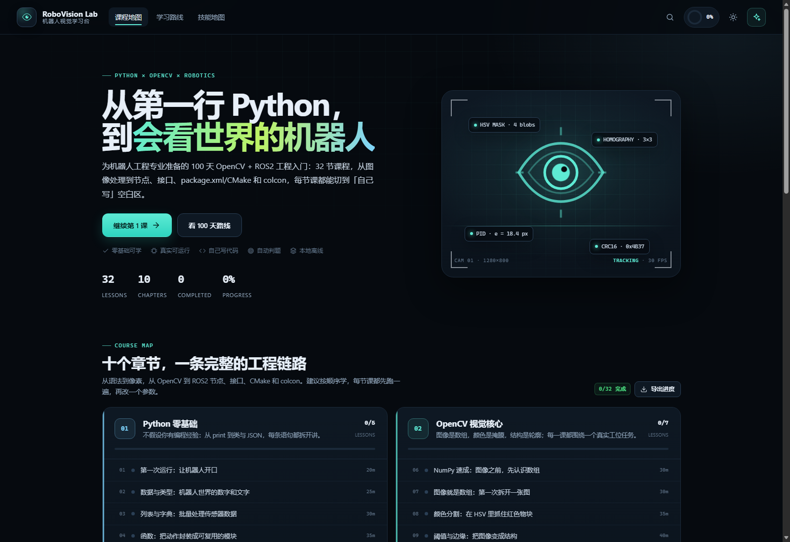
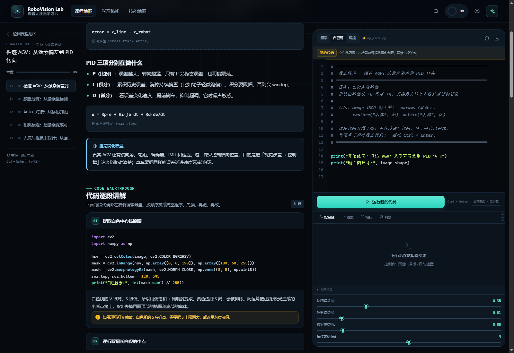
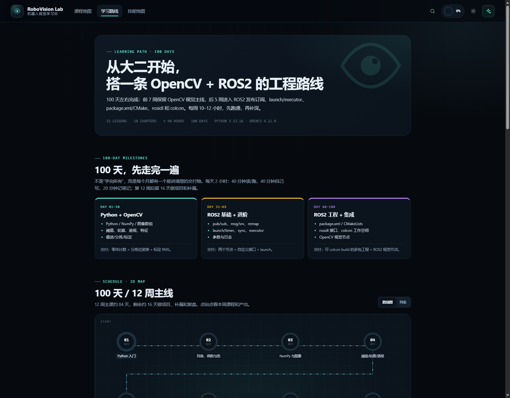
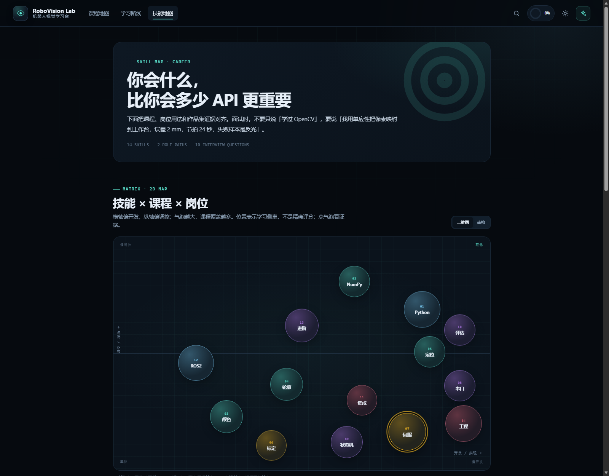
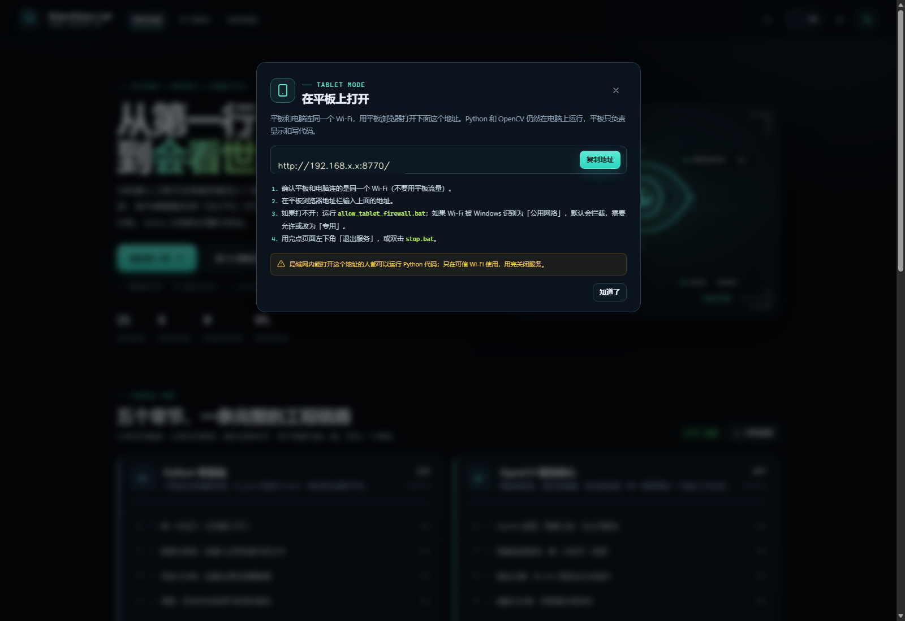

# RoboVision Lab · 机器人视觉学习台

面向机器人工程专业大二学生的 **OpenCV + ROS2 工程** 学习软件。  
32 节课程，100 天主线：前 7 周保留 OpenCV 视觉，后 5 周进入 ROS2 节点、接口、launch/executor、package.xml/CMake、rosidl 与 colcon；每节课都有「自己写」空白练习区。











> 全部在本地运行，不上传代码和图片。只有主动使用「AI 助教」时，才会把当前问题和代码发到配置的模型接口。

---

## 1. 快速开始

### 从 GitHub 克隆后（别人第一次运行）

前提：Windows 10/11，装好 **Python 3.10–3.13**，安装时勾选 **Add Python to PATH**。

```powershell
git clone https://github.com/<你的用户名>/RoboVision-Lab.git
cd RoboVision-Lab
setup.bat
start.bat
```

- **`setup.bat`**：创建 `runtime/` 虚拟环境，安装 OpenCV/NumPy（首次需要网络，约 50MB）。
- **`start.bat`**：启动本地服务，并打开 Edge/Chrome 应用窗口；地址是 `http://127.0.0.1:8770/`。
- 仓库里**没有** `runtime/`，这是正常的；不要去找它，`setup.bat` 会生成。
- 没有 API key 也能学全部课程；只有「AI 助教」需要 `data/ai_config.json`（不随仓库提供）。
- 关闭方式：页面左下角「退出服务」，或双击 `stop.bat`。
- 端口默认 `8770`；被占用会自动往后找，以实际打印/打开的地址为准。

如果不想用 Git：在 GitHub 页面 **Code → Download ZIP**，解压后同样先运行 `setup.bat`，再运行 `start.bat`。

### 本机已有项目

双击桌面上的 **「机器人视觉学习台」** 快捷方式，或项目里的：

```text
start.bat
```

`start.bat` 发现没有 `runtime/` 时会自动调用 `setup.bat`；但手动先跑一次 `setup.bat` 更容易看到安装报错。

### macOS / Linux

项目主体是 Python，可以手动运行：

```bash
python3 -m venv runtime
source runtime/bin/activate
pip install -r requirements.txt
python server.py
```

浏览器打开 `http://127.0.0.1:8770/`。`.bat` 启动器只适用于 Windows；Linux/macOS 未做完整桌面集成测试。

### 平板 / 手机访问

可以在平板上用，但**不是把 Python 装进平板**：平板只作为浏览器/编辑器，Python 和 OpenCV 仍然在电脑上执行。

1. 电脑和平板连**同一个 Wi-Fi**。
2. 在电脑上双击 `start_tablet.bat`。它会先关掉「仅本机」服务，再以局域网模式重启。
3. 在电脑页面左下角点 **「平板访问」**，复制显示的 `http://192.168.x.x:8770/` 地址。
4. 在平板浏览器打开这个地址。首次 Windows 可能弹防火墙提示，勾选允许；如果平板打不开，运行 `allow_tablet_firewall.bat`（需要管理员）。
5. 用完点页面左下角「退出服务」，或双击 `stop.bat`。

注意事项：

- 如果电脑的 Wi-Fi 被 Windows 识别为「公用网络」，默认会拦截入站连接；需要允许防火墙，或把该 Wi-Fi 改成「专用」。
- 有些公共 Wi-Fi / 手机热点开了「客户端隔离」，设备之间不能互访；换一个路由器或关闭隔离。
- **局域网模式没有登录验证**：同一 Wi-Fi 下能打开地址的人都能运行电脑上的 Python 代码。只在可信网络使用，不要做公网端口映射。
- 平板写代码建议配蓝牙键盘；触屏更适合看讲解、点运行、拖参数。
- 完全离线、只靠平板运行 OpenCV 需要改成 Pyodide/OpenCV.js 架构，当前版本没有走这条路线。

手动启动（调试用）：

```powershell
runtime\Scripts\python.exe server.py
```

浏览器打开 `http://127.0.0.1:8770/`。

---

## 2. 学什么

| 章节 | 内容 | 你会做出什么 |
|---|---|---|
| 01 Python 零基础 | print、类型、列表字典、函数、类与 JSON | 能读写传感器日志的小脚本 |
| 02 OpenCV 视觉核心 | 图像数组、HSV、阈值/边缘、轮廓、透视、模板/ORB | 颜色分割、计数、文档拉正、目标定位 |
| 03 机器人视觉实战 | 循迹 PID、颜色分拣 + 单应性、ArUco 对接、相机标定、光流 | 像素→毫米、位姿、速度、控制指令 |
| 04 控制与工程化 | 串口 CRC、状态机、数据集评估、单元测试 | 可靠的通信与可复现的指标 |
| 05 结课项目 | 视觉 → 规划 → 串口 → 状态机 → 节拍 | 智能分拣站检测报告 |
| 06 ROS2 基础 | pub/sub、msg/srv、namespace/remap、QoS | 两个可通信节点 + 自定义接口 |
| 07 ROS2 进阶 | launch/timer、message_filters、executor/回调组、参数/日志 | launch 编排 + 同步 + 参数 YAML |
| 08 ROS2 工程 | package.xml、ament_cmake、rosidl、colcon、overlay | 可 `colcon build` 的多包工作空间 |
| 09 ROS2 视觉集成 | OpenCV 检测 → Detection → 话题发布 | ROS2 视觉节点 |
| 10 GitHub 复刻（选修） | MIT 旋转角检测项目、SIFT/FLANN/单应 | 可复现的 GitHub 项目 README |

> Halcon、FOC/EtherCAT 内容已归档到 `content/archive/`，不在 100 天主线上；它们适合作为后续专业方向，不占当前 OpenCV + ROS2 的学习时间。

每节课包含：

1. **你将学会**：3 条可验证的目标。
2. **原理讲解**：为什么这么做、适用边界、常见坑。
3. **代码逐段讲解**：每段代码配一段解释，和右侧编辑器一一对应。
4. **可运行代码**：`Ctrl + Enter` 运行，输出控制台 / 图像 / 指标 / 判题。
5. **「自己写」空白练习区**：点编辑器上方「自己写」，从零写自己的程序；不会覆盖课程代码，也不会自动判题。
6. **动手任务**：开发型、调控型、观察型三类。
7. **小测**：选答案立刻看解释。

### 怎么「自己写」

1. 打开任意一节课，点标题右边的 **「自己写」**，或编辑器上方的 **「自己写」** 标签。
2. 编辑器会切成一张新的练习纸，里面只有任务提示和可用变量；把提示删掉，写你自己的代码。
3. 点 **「运行我的代码」**（或 `Ctrl + Enter`），结果出现在下方。
4. 再点 **「跟学」** 回到课程代码；点 **「调控」** 锁定代码、只调参数。
5. 你的代码按课程分别保存在浏览器里，刷新/切换课程不会丢；也可以点下载按钮导出 `.py`。

> ROS2 的 rclpy/C++/CMake 代码块标注为「只读」，因为本软件在 Windows 本地运行、没有装 ROS2；每节课用纯 Python 模拟节点/launch/同步/参数/构建逻辑，真实编译需在 Ubuntu/WSL2 的 ROS2 环境里复制代码。OpenCV 课程可直接运行。

### 读代码、改代码、写代码

未来不是“只会写”或“只会看”。初级视觉应用/调控岗位，大量时间在读现有代码、改配置、定位现场问题；但不会写就改不动。建议按 **读 50% / 改 30% / 写 20%** 练：

1. **读**：画出输入/输出、坐标系、单位、频率、状态和异常路径。
2. **改**：一次只改一个参数/字段/话题/分支，保留 diff，跑回归。
3. **写**：从空白写一个最小节点/函数/测试，再逐步加功能。

每节课先「跟学」读，再「调控」改参数，最后「自己写」；每周留一张数据流图、一个 diff、一个可运行文件。完整检查表：

[代码阅读检查表.md](代码阅读检查表.md)

另外还有：

- **学习路线**：100 天 / 12 周 ROS2 + OpenCV 主线、开发/调控岗位、技术栈、FAQ。
- **详细计划**：[100天ROS2计划.md](100天ROS2计划.md)，含每周课程、产出、ROS2 环境和复盘模板。
- **技能地图**：14 项技能 × 课程 × 岗位 × 作品集证据、10 个面试问题、作品集清单。
- **二维动图**：12 周路线是一条会流动的 2D 路径，技能是一张「开发 × 调控」气泡图；点节点/气泡看详情，也可一键切回列表/表格。
- **GitHub 复刻**：`projects/github-rotation/` 保留 MIT 许可、原始链接、静态版脚本和复现说明。
- **课程代码 / 我的代码 / 调控**：三个独立标签，随时切换；自己的代码按课程分别保存在浏览器里。
- **调控模式**：锁定代码，只拖参数，适合练习 PID/HSV/阈值整定。
- **AI 助教**：结合当前课程代码回答问题（需配置 key，见第 6 节）。

---

## 3. 目录

```text
RoboVision-Lab/
├─ start.bat              双击启动（仅本机）
├─ start_tablet.bat       启动局域网模式，供平板访问
├─ allow_tablet_firewall.bat  允许 8770-8789 端口（需管理员）
├─ stop.bat               关闭本地服务
├─ setup.bat              重建运行环境
├─ server.py              本地 HTTP 服务 + API
├─ runner.py              单课执行器（文本/视觉/判题）
├─ content/               课程源文件（ch1 ~ ch10；archive/ 为归档）
├─ projects/
│  └─ github-rotation/    MIT 项目复刻（README、静态版脚本、LICENSE）
├─ tools/
│  ├─ build_lessons.py    生成 data/lessons.json
│  ├─ make_samples.py     生成合成样图
│  ├─ selftest.py         逐课真实运行 + 判题回归
│  └─ ...                 调试与 UI 测试脚本
├─ data/
│  ├─ lessons.json        课程数据（由 content/ 生成）
│  └─ samples/            示例图（合成 + MIT 项目样图）
├─ docs/                  截图与说明
├─ 100天ROS2计划.md       100 天每周计划、ROS2 环境、构建清单
├─ web/
│  ├─ index.html
│  ├─ css/app.css
│  └─ js/app.js
├─ runtime/               独立 Python 环境（不进 Git）
└─ runs/                  每次运行的代码/图片/指标（自动清理）
```

---

## 4. 修改或新增课程

课程内容在 `content/ch*.py`，用 Python 数据结构描述，构建时生成 JSON。

```powershell
runtime\Scripts\python.exe tools\build_lessons.py --strict
runtime\Scripts\python.exe tools\selftest.py
```

- `lesson(...)` 的 `walkthrough` 是代码段列表，`starter` 会自动按顺序拼起来。
- 新增/修改代码段后，务必跑 `selftest.py`；它会用真实 OpenCV 执行每一课并检查判题表达式。
- 样图由 `tools/make_samples.py` 生成；换图后重新跑一遍自测。
- 判题表达式在 `tests` 里，能访问课程代码里的变量（如 `image`、`result`、`blocks`），返回 `True` 即通过。

---

## 5. 快捷键

| 快捷键 | 作用 |
|---|---|
| `Ctrl + Enter` | 运行当前代码 |
| `Ctrl + K` | 搜索课程 |
| `Tab` | 插入 4 个空格 |
| `Esc` | 关闭弹窗 / AI 面板 |

代码和进度存在浏览器 `localStorage`；换浏览器或清缓存会丢失，重要代码可用「下载 .py」或「导出学习进度」。

---

## 6. AI 助教（可选）

编辑 `data/ai_config.json`：

```json
{
  "key": "你的 API Key",
  "model": "deepseek-v4-pro",
  "base_url": "https://dashscope.aliyuncs.com/compatible-mode/v1"
}
```

- 不配置也能正常学完所有课程，AI 面板会提示未配置。
- `data/ai_config.json` 已加入 `.gitignore`，**不要把它发给别人或提交到 Git**。
- 只支持 OpenAI 兼容的 `/chat/completions` 接口。

---

## 7. 常见问题

**双击没反应 / 窗口一闪而过**  
用命令行运行 `start.bat`，看报错；或直接运行 `runtime\Scripts\python.exe server.py`。

**提示 OpenCV 未安装**  
运行 `setup.bat`，或手动：

```powershell
runtime\Scripts\python.exe -m pip install -r requirements.txt
```

**端口被占用**  
服务会自动从 8770 往后找。启动窗口会打印真实 URL；不要同时开多个实例（第二个实例会直接打开已有页面）。

**图片是黑图 / 结果不对**  
先看控制台报错和「判题」页；再恢复初始代码跑通基线，最后才改参数。所有样图都是合成的，不依赖摄像头。

**能接自己的摄像头吗？**  
可以。课程之外用 `cv2.VideoCapture(0)`；本学习台的运行器是离线批处理，不会实时读摄像头。真实项目建议用 ROS2/厂商 SDK 取流。

**AI 报错**  
检查 key、余额、模型名和网络；公司网络可能需要代理。AI 不可用不影响课程。

---

## 8. 安全说明

本项目的「分拣站」「机械臂指令」都是**教学仿真**，只生成协议帧和坐标，不会驱动真实设备。  
真实工作站必须有急停、安全光栅、碰撞检测、权限管理和风险评估；不要把教学代码直接接到真实机械臂上。

---

## 9. 隐私说明

- 软件**不需要注册账号**，没有埋点/遥测；课程进度和草稿保存在浏览器 `localStorage`，换浏览器/清缓存会丢。
- 代码和图片默认只在本地处理；只有主动点「AI 助教」时，才会把当前问题和代码发到 `data/ai_config.json` 配置的模型接口。
- `data/ai_config.json` 含 API key，**不要提交**；`.gitignore` 已排除。若 key 曾进入 Git 历史，先去模型平台 revoke/轮换。
- 局域网模式没有登录验证，同一 Wi-Fi 下能打开地址的人都能执行电脑上的课程代码；只在可信网络使用。
- 发布到 GitHub 前检查：`runtime/`、`runs/`、`tmp/`、`.server.json`、`data/ai_config.json` 都不在提交里；`docs/screenshot-tablet.png` 中的局域网 IP 已打码。
- Git 提交会公开 `user.name` / `user.email`；介意的话在 GitHub 设置里开启「Keep my email addresses private」，并使用 `ID+username@users.noreply.github.com`。
- **不要用 GitHub 网页“上传整个文件夹”**：网页上传不会读取 `.gitignore`，可能把 key、runtime 一起传上去。用 Git 命令行或 GitHub Desktop。

---

## 10. 环境

- Windows 10/11
- Python 3.10–3.13（本项目在 3.13.16 上验证）
- OpenCV 4.11.0（contrib，含 ArUco）
- NumPy 2.2.6
- 前端零构建、零 CDN，离线可用

课程图片大部分为本地合成；GitHub 复刻章节的参考图来自 MIT 项目，声明见 `THIRD_PARTY_NOTICES.md`。

---

## 11. 发布到 GitHub

本地已准备好：

- `LICENSE`（MIT）
- `THIRD_PARTY_NOTICES.md`（GitHub 复刻项目与依赖声明）
- `.gitignore`（排除 `runtime/`、`runs/`、`data/ai_config.json`、`.server.json` 等）

完整步骤见 [GITHUB发布指南.md](GITHUB发布指南.md)。  
最短流程：

```powershell
cd $env:USERPROFILE\Desktop\RoboVision-Lab
git init
git add .
git status --short
git commit -m "feat: initial RoboVision Lab"
git branch -M main
git remote add origin https://github.com/<你>/RoboVision-Lab.git
git push -u origin main
```

推送前务必确认 `git status` 里没有 `runtime/` 和 `data/ai_config.json`。  
如果 API key 曾进入 Git 历史，先去模型平台 revoke，再清理历史。

License：MIT，见 [LICENSE](LICENSE)。
